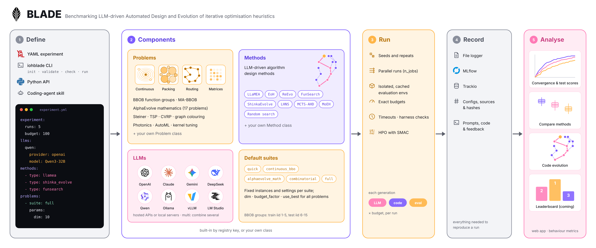
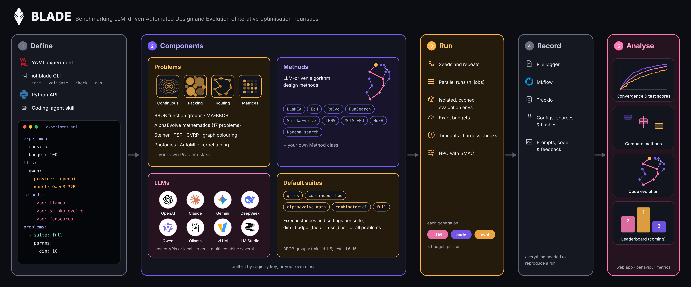

:hide-toc:

BLADE
=====

**Benchmarking LLM-driven automated algorithm design.** BLADE runs methods
such as LLaMEA, FunSearch and EoH that let a large language model write and
improve optimisation algorithms, on fixed benchmark suites, with the same
budget for every method.

.. grid:: 1 2 2 2
   :gutter: 3

   .. grid-item-card:: :octicon:`rocket` Get started
      :link: Quickstart
      :link-type: doc

      Install BLADE and run a first benchmark in five minutes.

   .. grid-item-card:: :octicon:`file-code` Experiments in YAML
      :link: yaml_experiments
      :link-type: doc

      LLMs, methods, problems and suites in one file; validate, check, run.

   .. grid-item-card:: :octicon:`tools` Extend BLADE
      :link: tutorial_custom_problem
      :link-type: doc

      Bring your own problem, search method or LLM.

   .. grid-item-card:: :octicon:`graph` Analyse results
      :link: webapp
      :link-type: doc

      Web app, convergence plots, code evolution and tables.

Quick start
-----------

.. tab-set::

   .. tab-item:: Command line

      .. code-block:: bash

         pip install iohblade
         iohblade init my-exp                       # a starter experiment
         iohblade validate my-exp/experiment.yml    # every mistake, with its line number
         iohblade check my-exp/experiment.yml       # smoke test, no LLM calls
         iohblade run my-exp/experiment.yml         # run (rerun to resume)

   .. tab-item:: experiment.yml

      .. code-block:: yaml

         experiment: {output_dir: results/my-exp, runs: 5, budget: 50}
         llms:
           qwen: {provider: ollama, model: "qwen2.5-coder:14b"}
         methods:
           - {type: llamea, name: "LLaMEA-{llm}", llm: qwen}
           - {type: random_search, name: "RS-{llm}", llm: qwen}
         problems:
           - {suite: quick}

At a glance
-----------

.. raw:: html

   

     
<b>26</b>benchmark problems in 19 suites

     
<b>9</b>LLM-driven design methods

     
<b>7+</b>LLM providers, hosted or local

     
<b>1</b>YAML file per experiment

   

Cite BLADE
----------

If you use BLADE in your research, please cite the
`GECCO '25 paper <https://doi.org/10.1145/3712255.3734347>`_ (BibTeX on the
:doc:`Introduction` page).

.. toctree::
   :hidden:
   :caption: Get started

   Introduction
   Installation
   Quickstart
   videos

.. toctree::
   :hidden:
   :caption: User guide

   yaml_experiments
   benchmarks
   methods_overview
   llm
   fitness
   webapp
   troubleshooting

.. toctree::
   :hidden:
   :caption: Extending BLADE

   tutorial_custom_problem
   tutorial_custom_method
   tutorial_custom_llm
   coding_agents

.. toctree::
   :hidden:
   :caption: Examples (Python API)

   notebooks/simple_experiment
   notebooks/custom_problem
   notebooks/custom_method
   notebooks/visualization_options
   notebooks/mabbob_example

.. toctree::
   :hidden:
   :caption: Reference

   cli
   modules
   changelog
