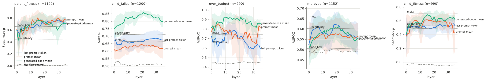
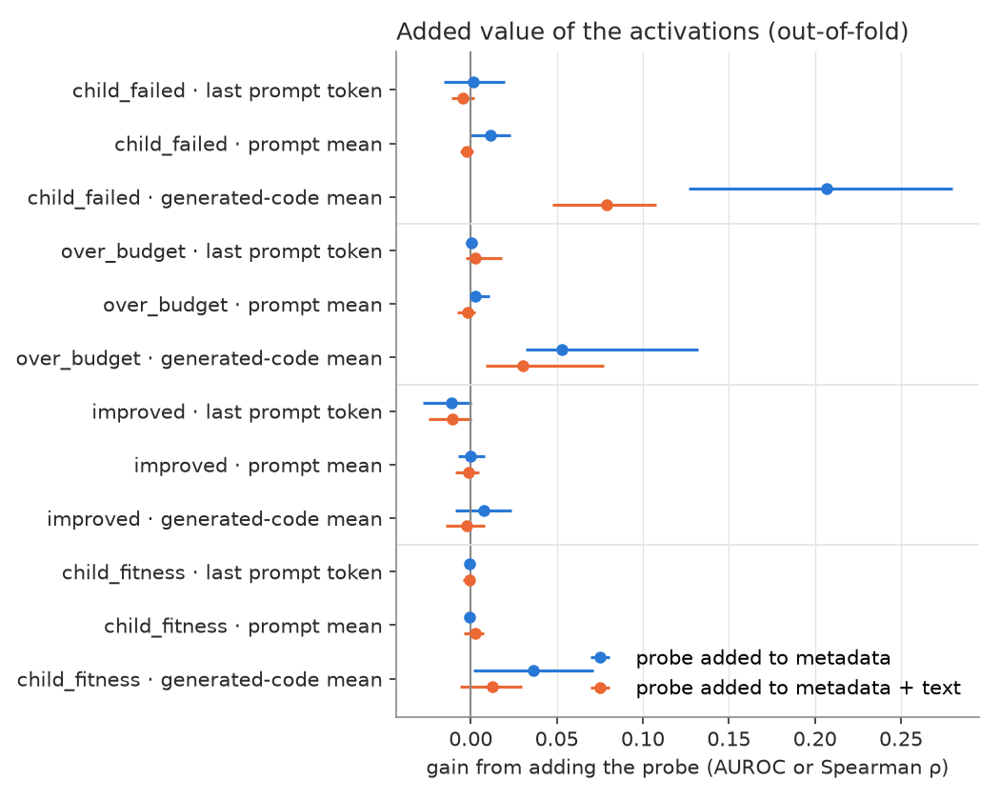
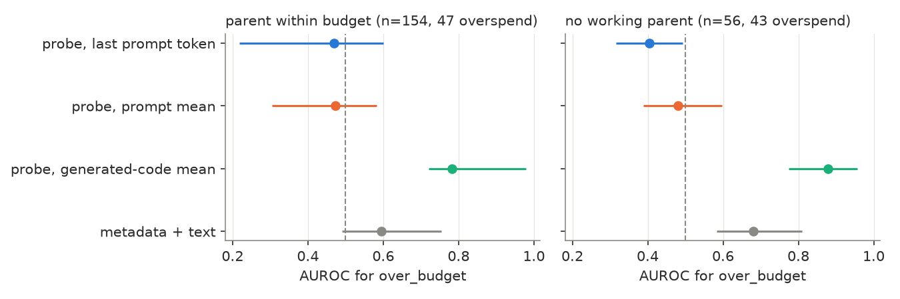
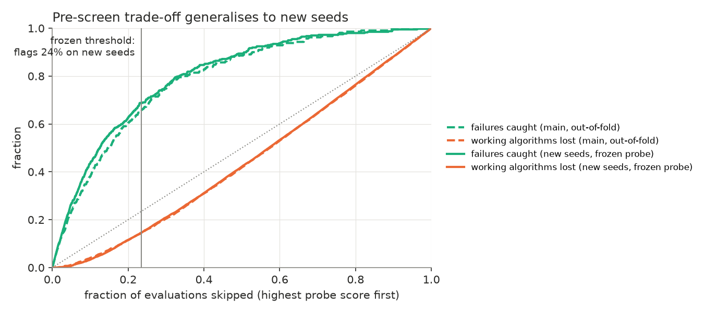
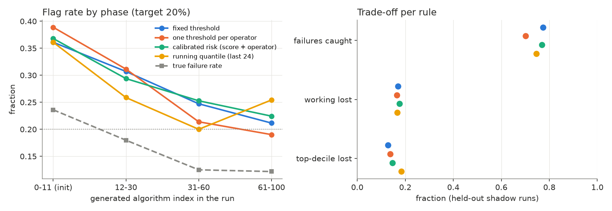
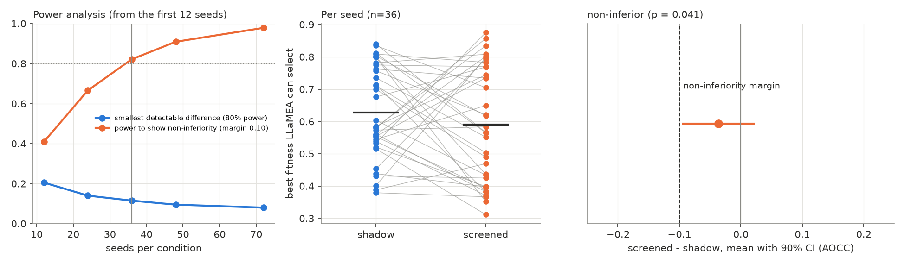
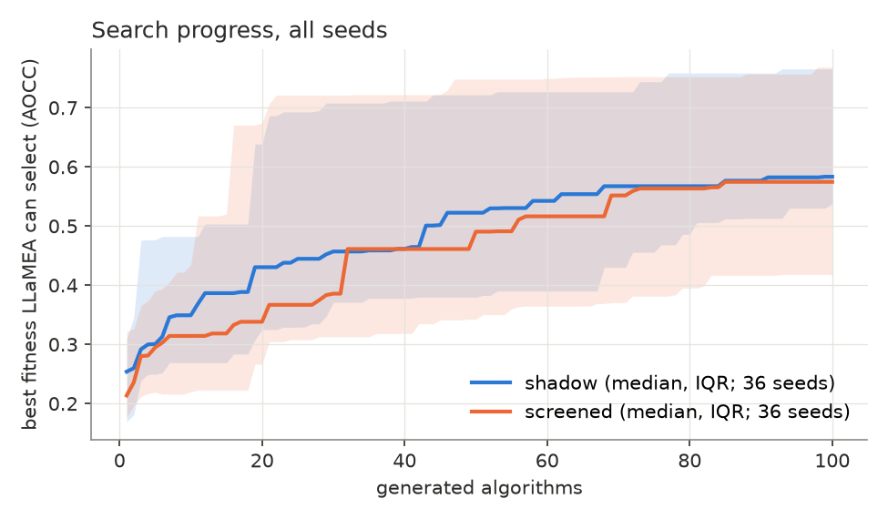
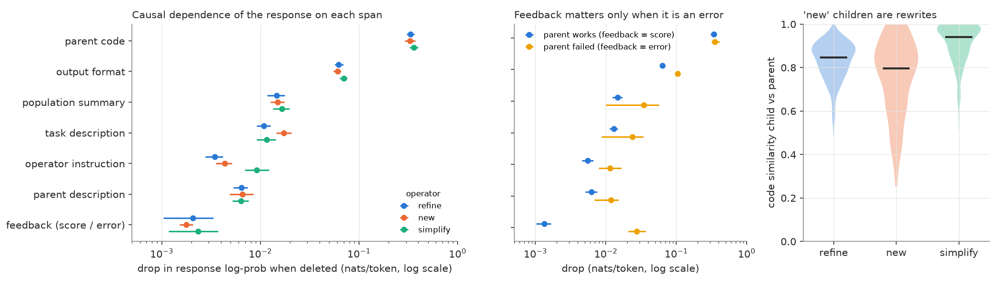

# Does the LLM know how its mutation will turn out?

Report on experiment 1 (probing), with the first step of experiment 2
(feedback attribution). BLADE / LLaMEA on MA-BBOB (5-D, AOCC), Qwen3-8B,
2026-11-04.

## Summary

- While writing a mutated algorithm, Qwen3-8B's residual stream encodes
  whether the code will **crash** (AUROC 0.85, layers 21–23) and whether it
  will **overspend the evaluation budget**. This is information that the
  code text, the output uncertainty and the search metadata do not carry
  (+0.08 AUROC on top of them).
- A frozen linear probe on that state works as a **free pre-screen**. On
  36 new seeds it skips ~21% of evaluations. Final search quality is
  **non-inferior** at a pre-registered 0.10 AOCC margin (p = 0.041), with
  a point estimate of −0.04.
- The model **represents parent fitness** (ρ ≈ 0.8) but **does not use
  it**: replacing the score in the feedback leaves the response unchanged.
  The edit is driven by the parent code; error messages are used, scores
  are not. Even the `new` operator rewrites the parent instead of starting
  over.

## Setup

LLaMEA (4 parents, 12 offspring, elitist; operators `refine`, `new`,
`simplify`) on MA-BBOB 5-D, 10 training instances, AOCC, with the
evaluation budget enforced. Qwen3-8B (thinking off, T = 0.8). For every
query, the residual stream of all 36 layers is recorded at three positions:
the last prompt token, the prompt mean and the mean over the generated
code. Linear (ridge) probes, cross-validated by LLaMEA run.

| Campaign | Seeds | Algorithms | Use |
|---|---|---|---|
| `main` | 12 | 1200 | train and select probes |
| `prescreen` | 12 × 2 conditions | 2400 | held-out test of the frozen probe, live |
| `prescreen2` | 24 × 2 conditions | 4800 | pre-registered non-inferiority test |

## 1. What is decodable, and what is new information

Shuffled-label controls stay at AUROC ≤ 0.53 on all layers.

Nested leave-one-run-out (layer chosen inside each fold), stacked with
metadata (M) and text (T: code TF-IDF, entropy, log-probability, length):

| Target | M | M+T | Probe (gen mean) | M+T+P | Gain from the probe |
|---|---|---|---|---|---|
| child crashes | 0.64 | 0.78 | 0.85 | 0.85 | **+0.08 [0.05, 0.11]** |
| child overspends | 0.91 | 0.93 | 0.94 | 0.96 | +0.03 [0.01, 0.08] |
| child improves | 0.66 | 0.68 | 0.61 | 0.68 | 0.00 |
| child fitness (ρ) | 0.77 | 0.80 | 0.68 | 0.81 | +0.01 |

- **H1 (parent fitness decodable): supported**, but redundant with the
  metadata.
- **H2 (failure decodable while writing): supported.**
- **H3 (improvement decodable): rejected.**

99% of children of an overspending parent overspend too, so metadata looks
strong for over-budget prediction. Within strata where the parent's status
cannot help, the prompt positions are at chance. The state while writing
still reaches 0.78–0.88, against 0.60–0.68 for M+T. **The prompt-level
signal is inherited from the parent; the state while writing is the
model's own.**

## 2. The probe as a pre-screen on new seeds

The crash probe (gen mean, layer 21) and its threshold (80th percentile of
`main`'s out-of-fold scores) were frozen. Each new seed was run twice:

- **shadow**: flags are only logged;
- **screened**: flagged code is reported to LLaMEA as rejected.

Every algorithm was still evaluated, so the true outcome is known for all
of them.

| | `main` (out-of-fold) | seeds 100–111 | seeds 112–135 |
|---|---|---|---|
| AUROC | 0.85 | 0.86 | 0.84 |
| Flagged | 20% | 23.5% | 22.9% |
| Failures caught | 60% | 69% | 66% |
| Working algorithms lost | 11% | 14.5% | 14.1% |
| Top-decile algorithms lost | 3% | 9.8% | 7.8% |

### Should the threshold adapt?

The fixed threshold flags ~35% of the initial population and ~22% later.
Three adaptive rules were fitted on `main` and replayed online on the
held-out shadow runs:

- one threshold per operator;
- a calibrated risk model (score + operator);
- a running quantile of the last 24 scores.

None is consistently better. The drift is not miscalibration: early
algorithms and the `new` operator really do fail more often (24% in the
first 12 vs 12% after 60). Equalising flag rates moves flags from risky to
safe code. The running quantile ranks first on one campaign (7.1% vs 10.0%
top-decile loss) and last on the other (18.3% vs 12.8%). **The fixed
threshold stays.**

## 3. Does acting on it harm the search?

On the first 12 seeds:
- the SD of the paired difference in best fitness was 0.23;
- the two conditions were uncorrelated (r = 0.06), because the runs
  diverge;
- only differences of at least 0.20 AOCC were detectable.

So, **before** running more seeds, we registered:
- the endpoint: best fitness LLaMEA can select;
- the non-inferiority margin: 0.10 AOCC;
- the test: one-sided paired t-test, α = 0.05, on 36 seeds (82% power).

| | shadow | screened |
|---|---|---|
| Best fitness, mean (median) | 0.628 (0.583) | 0.591 (0.575) |
| True failure rate | 16.5% | 17.1% |
| Evaluations skipped | 0 | 20.8% |

**Non-inferior:**
- mean difference −0.037, 90% CI [−0.096, +0.023], p = 0.041;
- the lower bound clears the margin by only 0.004;
- two-sided tests show no difference (Wilcoxon p = 0.25).

The rejection feedback does not teach the model to crash less (failure rate
p = 0.82).

**Reading.** Skipping a fifth of the evaluations costs at most a small
amount of final quality, and plausibly none. Showing that it costs less
than ~0.05 would need ~70+ seeds or a variance-reducing design, such as
common random numbers in the LLM sampling.

## 4. Experiment 2, step 1: what drives the edit?

360 recorded mutation queries from `main` (120 per operator), re-scored
with teacher forcing. Each prompt span is deleted in turn, and the drop in
the response's log-probability is measured. The parent's score is also
replaced by 0.010 or 0.900 (a counterfactual). Gradient × input on the
input embeddings serves as a second view.

| Span deleted | Drop (nats/token) | Gradient × input share |
|---|---|---|
| parent code | 0.33–0.36 | 52% |
| output format | 0.06–0.07 | 8% |
| population summary | 0.015 | 16% |
| task description | 0.011–0.017 | 11% |
| operator instruction | 0.003–0.009 | 1.4% |
| feedback | 0.002 | 2% |
| score 0.196 → 0.010 / 0.900 | < 0.001 | — |

- **The parent code dominates, for every operator.** `new` depends on it
  as much as `refine` does. Its children are rewrites: median similarity
  to the parent is 0.80 (refine 0.85, simplify 0.94).
- **The score is ignored; error messages are used.** Deleting the
  feedback matters 20× more when the parent crashed (0.027 vs 0.001).
- **Link to experiment 1.** Parent fitness is decodable at layer 15 but
  does not influence the edit. The representation exists but is unused.

### Next steps in experiment 2

1. **Generation-level counterfactuals.** Resample with the score changed
   or the error removed, then compare the edits (AST diff) and the child
   fitness.
2. **The over-budget message.** Add the message that MA-BBOB omits and
   test whether it changes behaviour.
3. **Patching the fitness direction.** Patch the exported parent-fitness
   direction at layer 15 and test whether the edit changes.
4. **Attribution graphs.** Use `circuit-tracer` with the Qwen3-8B
   transcoders on selected error-driven edits.

## Reproduce

See `exp01_probing/README.md` (steps 1–9) and
`exp02_feedback_attribution/README.md`. The figures come from
`exp01_probing/notebooks/01_probe_analysis.ipynb`,
`02_followup_analysis.ipynb` and
`exp02_feedback_attribution/notebooks/01_span_attribution.ipynb`.
