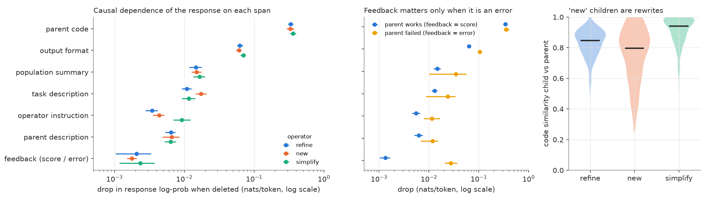
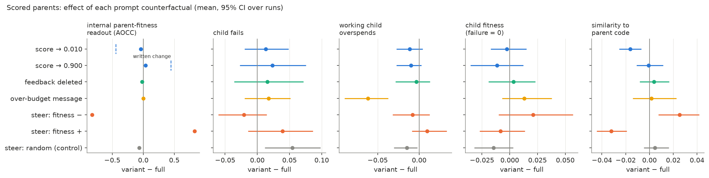
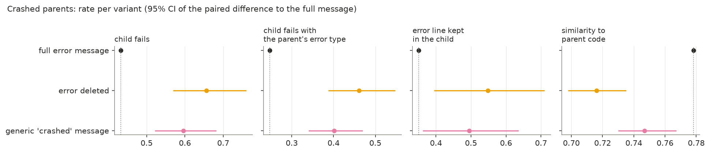
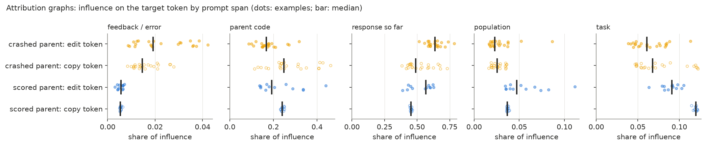

# Does the LLM use the feedback it is given?

Report on experiment 2 (feedback attribution). BLADE / LLaMEA on MA-BBOB
(5-D, AOCC), Qwen3-8B, 2026-11-04 to 2026-11-05. Experiment 1's report:
`REPORT.md`.

Replication on Qwen3-14B and Gemma-3-12B-it: `REPORT_replication.md`.

## Summary

- **Error traces are used to fix the code.** Deleting the error message of
  a crashed parent raises the child's failure rate from 43% to 66%,
  mostly with the parent's own exception. A generic "the algorithm
  crashed" message recovers only 27% of that: the model uses the
  *content* of the error, not just the fact of a crash.
- **The written score is ignored.** Changing it by ±0.44 AOCC, in both
  places where the prompt shows it, moves the model's internal fitness
  estimate by only ±0.04, and the child does not change. The model forms
  its estimate of parent quality from the code.
- **That internal estimate is causal for how much is rewritten.**
  Steering it towards "good parent" makes the child *less* similar to the
  parent; towards "bad parent", more similar. A random direction of the
  same size does neither.
- **Attribution graphs agree with the behaviour.** At the token where a
  fix departs from the crashed parent's code, the error message's share
  of influence is 61% higher than at a copied token next to it (14 of 16
  pairs), and the parent code's share is 38% lower.
- **The over-budget message that MA-BBOB omits helps a little.** It cuts
  overspending among the children of overspending parents from 99.6% to
  93.5%, without changing fitness.

## Setup

LLaMEA's mutation prompt contains, in order: the task, a population
summary (names and scores), the selected parent's description and code,
the feedback (score or error trace), the operator instruction (`refine`,
`new`, `simplify`) and the output format. Queries come from the recorded
experiment 1 runs (Qwen3-8B, thinking off, T = 0.8, top-p = 0.95).

| Step | Method | Queries | Question |
|---|---|---|---|
| 1 | span deletion, teacher forcing | 360 | which span does the recorded response depend on? |
| 3–5 | prompt counterfactuals, resampled and evaluated | 192 × 4–8 variants × 4 | does changing a span change the child? |
| 6 | attribution graphs (circuit-tracer + transcoders) | 36 × 2 targets | where does the influence on an edit token come from? |

## 1. Step 1 (recap): what the recorded response depends on



Deleting the parent code costs 0.33–0.36 nats per response token, 5×
more than any other span, for every operator. Even `new` rewrites the
parent (median similarity 0.80). Deleting the feedback matters 20× more
when the parent crashed (0.027 vs 0.001 nats per token). Replacing the
score by 0.010 or 0.900 changed the response's log-probability by < 0.001.

**A confound found later.** Step 1 changed the score only in the
feedback. The population summary still listed the parent's true score at
full precision. "The score is ignored" could therefore have meant "the
score is read from the population list". Steps 3–5 change both.

## 2. Generation counterfactuals: design

192 recorded mutation queries, in two strata:

- **scored parents**: 96 queries from `main`, 32 per operator, 12 runs;
- **crashed parents**: 96 queries, pooled from `main` and the shadow
  runs of experiment 1's pre-screen campaigns (crashed parents are rare),
  32 runs.

Variants per query:

| Stratum | Variant | Change |
|---|---|---|
| scored | `score_low` / `score_high` | score set to 0.010 / 0.900 in the feedback and the population list (−0.44 / +0.45 AOCC on average) |
| scored | `no_feedback` | feedback deleted |
| scored | `budget_msg` | "the algorithm exceeded the evaluation budget" (85 queries whose parent overspent) |
| scored | `steer_up` / `steer_down` | ± 2·v added to the residual stream at layer 15, all positions |
| scored | `steer_random` | random direction orthogonal to v, same norm |
| crashed | `no_error` | error trace deleted |
| crashed | `error_generic` | error trace replaced by "the algorithm crashed" |

**Steering vector.** v is the difference of the mean layer-15 activation
(prompt mean) between parents in the top and bottom fitness terciles
(1122 queries; tercile gap 0.41 AOCC). |v| = 4.8, 8% of the activation
norm. Adding v moves experiment 1's parent-fitness probe by exactly the
tercile gap. The probe's own ridge direction could not be used: a shift
of 0.2% of the norm along it already reads as a 0.3 AOCC change, so it
picks up a low-variance direction, not one the model acts on (cosine
with v: 0.04).

**Common random numbers.** Each query is sampled 4 times per variant. The
sampling seed depends on the query and replicate, not on the variant, so
effects are paired within a query. Every child is evaluated on the same
budget-enforced MA-BBOB problem: 4180 children, 0 infrastructure errors.
Effects are variant − full, averaged within a query; 95% bootstrap CIs
resample LLaMEA runs.

## 3. Scored parents: the score does not reach the decision



| Variant | fitness readout | child fails | working child overspends | child fitness | similarity to parent |
|---|---|---|---|---|---|
| score → 0.010 | −0.039 [−0.043, −0.036] | +0.013 | −0.011 | −0.003 | −0.016 [−0.026, −0.007] |
| score → 0.900 | +0.038 [+0.034, +0.044] | +0.023 | −0.010 | −0.012 | −0.001 |
| feedback deleted | −0.017 | +0.016 | −0.004 | +0.003 | +0.004 |
| over-budget message | +0.002 | +0.018 | **−0.062 [−0.090, −0.037]** | +0.013 | +0.002 |
| steer fitness − | −0.83 | −0.021 | −0.008 | +0.021 | **+0.025 [+0.007, +0.042]** |
| steer fitness + | +0.83 | +0.039 | +0.010 | −0.008 | **−0.032 [−0.044, −0.019]** |
| steer random | −0.065 | **+0.055 [+0.012, +0.098]** | −0.015 | −0.014 | +0.005 |

Unmarked effects have CIs that include 0. Base rates: child fails 12.8%,
working child overspends 93%, child fitness 0.330, similarity 0.85.

- **The written score barely moves the internal estimate.** A ±0.44 AOCC
  change in the written score moves the fitness readout by ±0.04 (the
  dashed marks in the first panel show the written change). Failures,
  overspending and child fitness do not change. Step 1's conclusion
  survives the confound.
- **The internal estimate does matter.** Steering along v changes how
  much of the parent is kept: "good parent" → larger rewrite, "bad
  parent" → smaller. The random direction does not change similarity, so
  the effect is specific to v.
- **The direction is counter-intuitive.** One might expect a good parent
  to be refined conservatively. The written score points the other way
  (low score → slightly larger rewrite), so the two do not act through a
  single "how good is the parent" variable.
- **Steering has a generic cost.** The random push raises failures by 5.5
  points. The fitness direction's effects on failure are within that.
- **The over-budget message is used, weakly.** Children of overspending
  parents overspend 6 points less often (99.6% → 93.5%), with no gain in
  fitness. The message does not make the model write a budget check.

## 4. Crashed parents: the error trace is used



| Variant | child fails | fails with the parent's exception | keeps the error line | similarity | child fitness |
|---|---|---|---|---|---|
| full error trace | 0.432 | 0.247 | 0.351 | 0.778 | 0.119 |
| error deleted | **+0.224 [+0.137, +0.328]** | **+0.214 [+0.140, +0.301]** | **+0.197 [+0.043, +0.359]** | −0.062 [−0.080, −0.043] | −0.044 [−0.080, −0.019] |
| generic "crashed" | **+0.164 [+0.089, +0.250]** | **+0.154 [+0.092, +0.222]** | **+0.144 [+0.011, +0.285]** | −0.031 [−0.048, −0.011] | −0.025 [−0.047, −0.004] |

- Without the error trace, the extra failures are almost all the parent's
  own exception (+21 of +22 points): the model keeps the broken line
  (+20 points) because it does not know which line is broken.
- The model also rewrites more without it (similarity −0.06), but blindly.
- Knowing *that* it crashed recovers 27% of the effect; the exception
  type, message and line carry the rest.

## 5. Attribution graphs: the edit reads the error

**Method.** circuit-tracer 0.5 with the `mwhanna/qwen3-8b-transcoders`
(one transcoder per layer, 164k features). The context is the recorded
prompt plus the recorded response up to the target token. Two targets per
query:

- **edit token**: the first token where the child departs from the
  parent's code (an edit on the line named in the error, where there is
  one);
- **copy token**: the first token of the nearest earlier line copied
  unchanged (control).

The influence of every node (feature, transcoder error node, token
embedding) on the target logit is summed by the prompt span at its
position. Working children only; 24 crashed and 12 scored queries, the
shortest contexts that qualified (1000–1800 tokens). 69 of 72 graphs fit
in memory, ~10 min each on a 96 GB GPU.

**Example.** The parent crashed with

```
TypeError: gradient() got an unexpected keyword argument 'epsilon'
On line: grad = np.gradient(func, x, epsilon=1e-6)
```

The child writes `grad = np` and then departs from the parent:
`.zeros` instead of `.gradient`. At that token, the error message carries
3.6% of the influence, against 1.2% at the copied line before it.



| Share of influence | crashed: edit | crashed: copy | scored: edit | scored: copy |
|---|---|---|---|---|
| response so far | 0.635 | 0.523 | 0.527 | 0.453 |
| parent code | 0.174 | 0.273 | 0.233 | 0.241 |
| task | 0.064 | 0.076 | 0.089 | 0.119 |
| population | 0.029 | 0.026 | 0.056 | 0.037 |
| feedback / error | 0.023 | 0.016 | 0.005 | 0.005 |
| replacement score | 0.09 | 0.10 | 0.10 | 0.15 |

**Paired edit − copy, crashed parents:**

| Pairs | Error share | Parent-code share |
|---|---|---|
| all 22 | +0.007 [+0.003, +0.011], p = 0.002 | −0.10 [−0.14, −0.07], p = 0.0001 |
| position-matched (copy is a body line just before the edit), 16 | **+0.010 [+0.006, +0.014], +61%, 14/16 positive, p = 0.0002** | −0.11 (−38%), p = 0.003 |

- **At the fix, the model reads the error more and the parent code
  less.** The increase comes from edits on the line named in the error;
  the 6 edits elsewhere show none.
- **The error steers specific tokens, not the whole rewrite.** It is 6–8%
  of the prompt tokens and carries 2–3% of the influence. The response
  written so far carries 50–65%.
- **Scored parents: no conclusion.** Their edits come early in the code,
  so the nearest copied line was always the `import` on the first line:
  the control differs in position as well as in role. The score's share
  is equally low (0.5%) at both targets.

**Caveat.** The replacement score is ~0.1: about 90% of the influence
passes through the transcoders' error nodes, which sit at a token
position but have no interpretation. The span shares say *where*
influence comes from; they are not yet a circuit. The transcoders were
trained on the base model; their reconstruction on the post-trained
model's activations is part of that gap.

## Conclusions

1. **LLaMEA's feedback channel works for errors, not for scores.** The
   model fixes what the error trace points at, and the fix draws on the
   error text. The score adds nothing that the model does not already
   infer from the code.
2. **Implication for prompt design.** Spending prompt tokens on scores,
   precise or not, buys nothing for the edit. Error traces should stay
   specific: a generic crash message loses most of their value. An
   explicit over-budget message helps a little and costs one line.
3. **The fitness representation is used, but not as a conservative
   refiner would use it.** It controls edit size, in the direction of
   "rewrite more when the parent looks good". This is a lever for steering
   exploration directly, independent of what the prompt says.
4. **Mechanistic evidence is consistent but shallow.** Attribution graphs
   confirm where the fix reads from, but at a replacement score of ~0.1
   they do not yet show how.

### Next steps

1. Scored parents with a position-matched control: later edits, a body
   line as the copy token.
2. Inspect the top error-span features: do they encode the exception
   type, the line, or "something went wrong"?
3. Per-operator split of the counterfactual effects, with more queries.
4. Experiment 3: richer feedback (BLADE behaviour metrics, budget use per
   instance) in new LLaMEA runs, and steering along v as an exploration
   control.

## Reproduce

See `exp02_feedback_attribution/README.md` (steps 1–6). The figures come
from `exp02_feedback_attribution/notebooks/01_span_attribution.ipynb` and
`02_counterfactuals.ipynb`. Graph summaries:
`exp02_feedback_attribution/results/cf/attribution_graphs.jsonl`.
