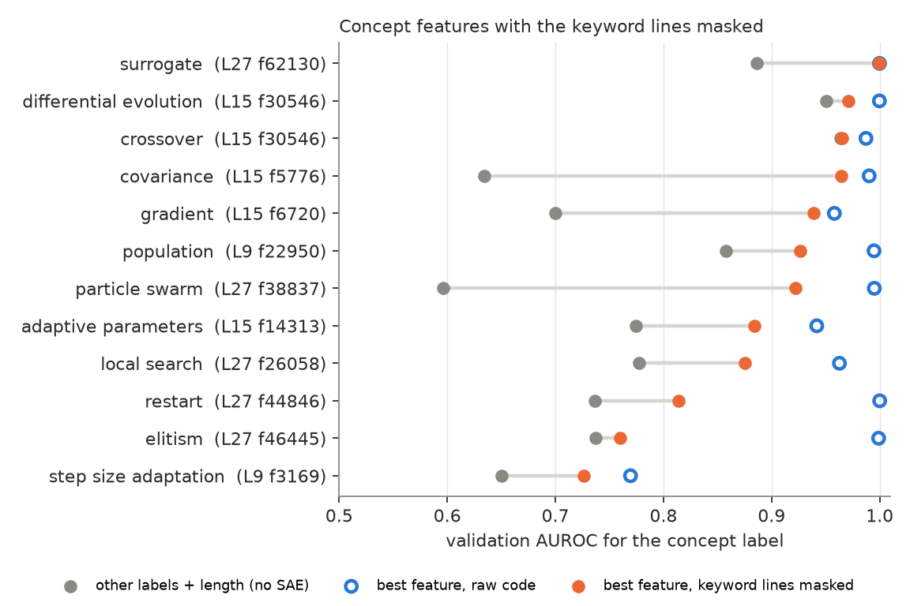
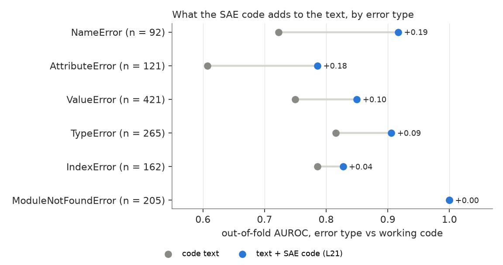

# What does the generator represent while it writes an algorithm?

Report on experiment 3 (algorithmic concept features). BLADE / LLaMEA on
MA-BBOB (5-D, AOCC), Qwen3-8B, 2026-11-07 to 2026-11-08. Previous
reports: `REPORT.md` (experiment 1, probing), `REPORT_exp02.md`
(experiment 2, feedback attribution), `REPORT_replication.md`.
Details, commands and every number: `exp03_concept_features/README.md`
and `exp03_concept_features/results/k100/`.

## Summary

- **Public SAEs for the base model work on the post-trained generator.**
  Qwen-Scope's TopK SAEs (k = 100, 65,536 features) leave 21–31% of the
  variance of the generated-code residual stream unexplained, and
  splicing them in recovers more than 99% of the loss relative to mean
  ablation.
- **Every metaheuristic concept has a feature that detects it**
  (validation AUROC 0.89–1.00; step-size adaptation 0.72–0.77). Most of
  the best features are keyword detectors (`mutant`, `restart`,
  `.velocity`).
- **Some features represent the concept, not the word.** With every line
  that contains a concept keyword masked, features for covariance
  learning, finite-difference gradients, particle swarms, surrogates,
  local search and adaptive parameters still detect their concept far
  beyond what co-occurring concepts predict (e.g. swarm 0.92 vs 0.60).
  Elitism and restart features are keyword detectors. The crossover and
  DE features read the DE family as a whole.
- **Concepts are not planned visibly before writing.** At the last prompt
  token, the SAE code adds almost nothing to the parent's concepts for
  predicting the child's concepts.
- **Concept features say what is implemented, not whether it works.**
  They add nothing to failure or fitness prediction once the code text is
  known. The rest of the SAE code adds +0.074 AUROC for failure
  [0.058, 0.089], the same gain as experiment 1's residual-stream probe,
  but spread over ~260 features.
- **The gain is largest where text cannot see the bug: references to
  things that do not exist.** NameError: +0.19 AUROC over text;
  AttributeError: +0.18.
- **The model represents an undefined name at the token where it writes
  it.** L21 f9410 is active on 72% of out-of-scope `func` references and
  on about half of other undefined names, against 0.3% of valid names.
  L21 f7944 fires on 55% of out-of-scope `func` and never on 7,128
  in-scope ones. Most of these solutions then fail with NameError. No
  feature tracks undefined `self` attributes.

## Setup

- **Data.** The three Qwen3-8B campaigns of experiment 1 (`main`,
  `prescreen`, `prescreen2`): 84 LLaMEA runs, 8,400 generated
  algorithms, with their evaluation outcome and error message.
- **Activations.** Per-token residual stream of the generated code
  (`HookedLLM.replay`, teacher forcing) at layers 9, 15, 21 and 27
  (of 36): the layers of experiment 1's probes plus one late layer.
- **SAE.** `Qwen/SAE-Res-Qwen3-8B-Base-W64K-L0_100` (TopK, k = 100),
  trained on the base model. Per solution, each feature is summarised
  by its max (and mean) over code tokens.
- **Concept labels.** 18 regex/AST labels on the code without comments
  and strings: population, crossover, DE, PSO, CMA-style covariance,
  gradient, surrogate, local search, restart, elitism, step-size
  adaptation, adaptive parameters, ...
- **Splits.** Feature selection on half of the runs, evaluation on the
  other half; outcome models use 10-fold `GroupKFold` over runs, and
  CIs are bootstraps over runs.

## 1. The SAEs transfer

On 48 queries, k100 explains 69–79% of the variance of the post-trained
model's code activations (base model: 74–82%). Replacing the residual
stream by the reconstruction raises the code loss from 0.043 to
0.08–0.14 nats/token; mean ablation raises it to ~9–12. k100 beats k50
at every layer. The fallback of training an SAE on LLaMEA code was not
needed.

## 2. Concept features, and which of them are more than keywords

For each concept, the top features by discovery AUROC were re-scored on
the validation runs with three masks over the concept's regex matches:
the keyword tokens, the whole lines containing a match, and a random
mask of the same size. The line mask is the real test, since the tokens
around a keyword carry it forward. The random mask changes the AUROC by
at most 0.003.

The reference (gray) is what the *other* concepts' labels plus code
length predict. A feature that only reads co-occurring concepts reaches
that, not more.

| group | concepts | best line-masked AUROC vs reference |
|---|---|---|
| beyond keyword and co-occurrence | covariance, gradient, particle swarm, surrogate, adaptive parameters, local search, population, step size | 0.965 vs 0.634; 0.939 vs 0.700; 0.922 vs 0.596; ≈1.0 vs 0.886; 0.884 vs 0.775; 0.876 vs 0.778; 0.926 vs 0.857; 0.727 vs 0.650 |
| co-occurrence | crossover, differential evolution | 0.965 vs 0.964; 0.962 vs 0.951 (one DE-family feature) |
| keyword detectors | elitism, restart | 0.57–0.60 (L27: 0.76 vs 0.737); 0.78–0.81 vs 0.737 |

- Ranking features by raw AUROC favours keyword detectors. The more
  conceptual features are often at rank 1–4 of a concept.
- Readable examples: finite-difference gradients (L15 f6720) peak on
  `x_plus`, `x_minus`, `(2 * eps)`; covariance construction (L15 f5776);
  a velocity/momentum feature shared by PSO and gradient momentum
  (L27 f46928).
- Masking tests where the evidence is read, not what is represented:
  later lines can still attend to a masked keyword.

## 3. No visible plan at the last prompt token

Whether the child contains a concept is predicted by the parent's
concepts (AUROC 0.81–0.95). The SAE code at the last prompt token adds
nothing to that. For children that *introduce* a concept the parent
lacks, it adds a little for step-size adaptation (0.61 → 0.69),
adaptive parameters (+0.05), gradients (+0.045) and swarms (+0.03). The
code-side concept features are never among the 100 active features at
that token. This matches experiment 1, where prompt positions added
nothing beyond metadata for any outcome.

## 4. Concepts vs outcomes

Blocks: M = experiment 1 metadata, L = the 18 labels + log length,
C = the 9 line-mask-robust concept features, A = all 240 selected
concept features, S = the whole SAE code (256 label-free SVD components
per layer), T = code TF-IDF.

| target | M+L | +C | +A | +S | M+L+T | +C | +S |
|---|---|---|---|---|---|---|---|
| failure (AUROC, n = 8,381) | 0.757 | +0.013 | +0.070 | **+0.120** | 0.804 | +0.001 | **+0.074** [0.058, 0.089] |
| over budget (AUROC, n = 6,968) | 0.921 | +0.004 | +0.015 | +0.016 | 0.935 | +0.002 | +0.004 [−0.002, 0.012] |
| fitness (Spearman, n = 6,968) | 0.746 | +0.001 | +0.006 | +0.016 | 0.749 | +0.001 | +0.012 [0.004, 0.018] |

- Concept features add nothing once the text is known: they record what
  the algorithm is made of, and the text says that too.
- Within the algorithms that use a concept, the feature's strength is
  mostly unrelated to the outcome. One exception: among PSO
  algorithms, a stronger swarm feature (L27 f38837) goes with lower
  fitness (Spearman −0.22 [−0.31, −0.13], n = 1,183).
- The failure signal of S is robust. It holds without surrogate
  algorithms, which fail 93% of the time (+0.086), within every
  mutation operator (+0.06 to +0.12), and after working and failing
  parents (+0.080, +0.146).
- It is not carried by a few features. L1 probes with fewer than ~10
  features add nothing beyond the text; 40 features recover half the
  gain; the full gain needs ~260 features at L21 (+0.089), the best
  layer, as for experiment 1's probe.
- Named contributors: scikit-learn Gaussian-process code (every
  scikit-learn import fails here: the package is not installed), matrix
  products, finite-difference gradients, `random.choice`. Toward working
  code: "numpy-only, class follows" and budget boilerplate features.

## 5. Failure by error type

Each error type against working code (text: TF-IDF logistic
regression; SAE: L1 probe at L21; text + SAE: stacked; out of fold):

| type | n | text | text + SAE | delta [95% CI] |
|---|---|---|---|---|
| NameError | 92 | 0.723 | 0.917 | +0.194 [0.139, 0.248] |
| AttributeError | 121 | 0.607 | 0.786 | +0.179 [0.108, 0.242] |
| ValueError | 421 | 0.749 | 0.850 | +0.100 [0.072, 0.129] |
| TypeError | 265 | 0.816 | 0.906 | +0.090 [0.053, 0.128] |
| IndexError | 162 | 0.786 | 0.827 | +0.042 [0.021, 0.063] |
| ModuleNotFoundError | 205 | 1.000 | 1.000 | 0 |

Errors about whether a name or attribute exists gain most. A bag of
words cannot relate a use to its definition. Timeouts are rare (9).

## 6. An "undefined name" representation

The most common NameError is `name 'func' is not defined`: the
objective, a parameter of `__call__`, used in a helper method that does
not receive it. Every name load and `self.<attr>` load in all 8,400
solutions was labelled with Python's scoping rules. Flagged solutions
fail 91–93% of the time, mostly with the matching error.

Fraction of tokens with the feature active, L21 (step 13: 588
solutions, 105k reference tokens):

| reference | n | f7944 | f9410 |
|---|---|---|---|
| `func` out of scope | 88 | 0.55 | 0.72 |
| other name bound in another function | 32 | 0.31 | 0.50 |
| name bound nowhere (`norm`, `scipy`, `j`) | 60 | 0.27 | 0.53 |
| `self.<attr>` never assigned | 205 | 0.05 | 0.17 |
| valid names | 84,310 | 0.000 | 0.003 |
| valid `self` attributes | 20,258 | 0.001 | 0.003 |
| all other code tokens | 360,543 | 0.000 | 0.003 |

- **Scope, not position.** In step 12, the 754 valid `func` references
  outside `__call__` (helpers that take `func`, closures) are as silent
  as those inside it. f9410 is the best of all 65,536 features at
  telling out-of-scope from in-scope `func` (token AUROC 0.857).
- **General for names.** f9410 fires on about half of every kind of
  undefined name. It ranks third of all features against valid names
  for both new groups; the two above it are unspecific or
  group-specific. f7944 is narrower, mostly `func`.
- **Not for attributes.** No feature separates never-assigned `self`
  attributes from valid ones (best token AUROC 0.61), although the
  class body is in context.
- **The model writes the bug anyway.** With an out-of-scope `func`, 40
  of 52 solutions fail with NameError and only 2 work.

## Limitations

- One model (Qwen3-8B) and one problem family. The SAEs are for the
  base model, and only Qwen3-8B has public residual SAEs.
- Concept labels are regex/AST heuristics. They are precise for
  keyword-defined concepts and noisy for step-size adaptation.
- All results are correlational. Experiment 5 tests the candidate
  directions causally.
- The undefined-reference sample is small (88 + 92 name tokens), and
  the labeller is static: it finds 73% of the logged NameErrors and 53%
  of the AttributeErrors. The misses are mostly dynamic (an attribute
  read before its assignment).
- Behaviour metrics (the planned three-way map) need re-runs with
  trajectory logging and were not done.

## Consequences for experiment 5

Steering candidates, all from features that survive line masking or
track scope:

- covariance L15 f5776, gradient L15 f6720, particle swarm L27 f38837,
  local search L27 f26058 (does steering add the concept to the code,
  and at what cost in validity?);
- undefined name L21 f9410 and f7944 (does suppressing them change the
  rate of undefined references, and does amplifying them create them,
  or make the model avoid them?).
