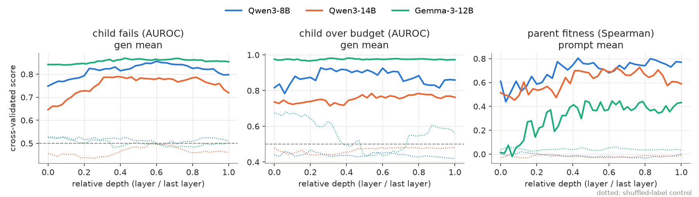

# Do experiments 1 and 2 replicate on other models?

Experiments 1 (probing) and 2 (feedback attribution) repeated on a bigger
model of the same family (**Qwen3-14B**, 40 layers) and on another family
(**Gemma-3-12B-it**, 48 layers). The original model is **Qwen3-8B**
(36 layers). BLADE / LLaMEA on MA-BBOB (5-D, AOCC), 2026-11-05 to
2026-11-07. Original reports: `REPORT.md` (experiment 1) and
`REPORT_exp02.md` (experiment 2).

All numbers come from `cross_model/results/summary.md`
(`cross_model/compare.py`).

## Summary

- **Child failure is decodable in all three models, and it is new
  information in all three.** Probe AUROC is 0.79–0.87. The probe adds to
  metadata + text in every model, with CIs above 0. The gain shrinks from
  +0.079 (8B) to +0.059 (14B) and +0.017 (Gemma), where code
  bag-of-words alone already reaches 0.83.
- **The pre-screen transfers to new seeds.** AUROC on held-out runs is
  0.81–0.87. What a fixed skip rate buys depends on the base failure
  rate. Gemma fails 42% of the time, and its screen is 93% precise and
  loses only 2% of working children. No model shows a significant effect
  on the best fitness found (12 seeds each).
- **The parent-fitness representation does not replicate cleanly.** In
  8B the probe beats every baseline (Spearman 0.80 vs 0.66). In 14B it
  ties the metadata baseline (0.735 vs 0.748). In Gemma it is below it
  (0.55 vs 0.66).
- **The response depends on the prompt in the same way in all three.**
  Deleting the parent code costs 0.24–0.34 nats/token, the format
  instructions 0.06–0.07, the feedback 0.002–0.004. Changing the written
  score barely changes anything (≤ 0.0004).
- **Error traces are used by all three, but only the Qwen models get
  better fixes out of them.** Without the error message, 8B and 14B fail
  22–24 points more often. Gemma keeps the failing line and repeats the
  same exception more often (+19 and +14 points), so it reads the
  message, but its failure rate does not change (+0.7 points; base 72%).
- **The written score is ignored by all three** (failures, fitness and
  rewrite size). The one exception is a small rise in Gemma's failures
  with a low score (+7.6 points, CI [+1.3, +14.3]). That is one of
  many effects tested per model, so it may be chance.
- **8B's steering result does not replicate.** In 8B, pushing the fitness
  direction towards "good parent" made the child less similar to the
  parent. In 14B the push is as strong, but similarity does not change
  (+0.011 [−0.001, +0.021], opposite sign). In Gemma the direction is
  not specific: a random push moves the readout almost as much.
- **The over-budget message helps in all three, and much more in 14B:**
  −35 points of overspending children, against −6 (8B) and −4 (Gemma).
- **Attribution graphs could not be run** for 14B and Gemma (see §5).

## Setup

Same pipeline and settings as the 8B runs; only the model changes.

| | Qwen3-8B | Qwen3-14B | Gemma-3-12B-it |
|---|---|---|---|
| Layers | 36 | 40 | 48 |
| Main campaign | 12 seeds × 100 | 12 seeds × 100 | 12 seeds × 100 |
| Held-out pre-screen | seeds 100–111 | seeds 100–111 | seeds 100–111 |
| Span deletion queries | 360 | 360 | 360 |
| Counterfactual queries (scored + error) | 96 + 96 | 96 + 57 | 96 + 73 |
| Counterfactual samples | 4180 | 3652 | 3948 |
| Steering layer | 15 | 30 | 31 |

Notes:

- **Different failure rates.** The models fail at different rates: in
  the main campaign 17.5% (8B), 11.8% (14B) and 37.8% (Gemma).
- **Gemma's over-budget target is degenerate.** 97.9% of Gemma's
  children overspend, which leaves about 16 children within budget. Its
  over-budget AUROC (0.98) and its noisy shuffled-label control mean
  little.
- **Fewer error queries for 14B and Gemma.** Fewer crashed-parent
  queries passed the selection in `03_prepare_counterfactuals.py`, so
  the error stratum is smaller.

## 1. What is decodable, and what is new information



Probe score per layer on relative depth, with each model's
shuffled-label control dotted.

| | Qwen3-8B | Qwen3-14B | Gemma-3-12B |
|---|---|---|---|
| Child fails: probe | 0.856 (L21, depth 0.60) | 0.790 (L15, 0.38) | 0.870 (L20, 0.43) |
| Child fails: best baseline | 0.711 (uncertainty) | 0.695 (metadata) | 0.830 (code BoW) |
| Child fails: M+T+P − M+T | **+0.079 [+0.048, +0.108]** | **+0.059 [+0.029, +0.091]** | **+0.017 [+0.006, +0.027]** |
| Over budget: probe | 0.927 | 0.784 | (0.982, degenerate) |
| Over budget: best baseline | 0.746 (metadata) | 0.804 (code BoW) | (0.953) |
| Over budget: M+T+P − M+T | **+0.030 [+0.009, +0.078]** | +0.011 [−0.013, +0.030] | −0.004 [−0.067, +0.047] |
| Parent fitness: probe (Spearman) | 0.804 (L15, prompt mean) | 0.735 (L21, gen mean) | 0.554 (L25, last token) |
| Parent fitness: best baseline | 0.656 (code BoW) | 0.748 (metadata) | 0.655 (metadata) |

AUROC unless noted. M = metadata, T = text (code TF-IDF, entropy,
log-probability, length), P = probe with nested layer choice. 95% CIs
come from a bootstrap over runs.

- **Child failure is the robust finding.** Every model represents it,
  and in every model the probe adds information beyond the text. The
  best layer sits at 0.4–0.6 of the depth.
- **The gain is smallest where the surface already tells.** Gemma's
  failures are easy to see in the code (bag-of-words AUROC 0.83), so the
  activations add little.
- **Over budget replicates only in 8B.** In 14B the code bag-of-words is
  as good as the probe.
- **Parent fitness is the weakest result.** Only 8B encodes it beyond
  what metadata and code already give. Experiment 2 built its steering
  vector on this representation, so this matters for §4.

## 2. The probe as a pre-screen on new seeds

The probe was frozen after the main campaign and applied on new seeds
(100–111), at the 20% skip rate used for 8B.

| | Qwen3-8B | Qwen3-14B | Gemma-3-12B |
|---|---|---|---|
| Failure rate | 16.5% | 12.5% | 41.7% |
| AUROC (held out) | 0.860 | 0.809 | 0.870 |
| Failures caught | 69% | 59% | 42% |
| Working children lost | 14.5% | 15.4% | 2.4% |
| Precision of a skip | 0.48 | 0.35 | 0.93 |
| Best fitness, screened vs shadow (median) | 0.650 vs 0.571 (p = 0.73) | 0.660 vs 0.628 (p = 0.79) | 0.642 vs 0.581 (p = 0.11) |

- **The ranking transfers to new seeds for every model.**
- **The base rate sets the operating point.** At a fixed 20% skip rate,
  a frequent failure (Gemma) gives a precise screen that misses many
  failures. A rare failure (14B) gives an imprecise screen.
- **None of the search effects is significant at n = 12.** The 8B effect
  was also not significant at n = 36 (`REPORT.md` §3).

## 3. What the response depends on (span deletion)

| Deleted span (nats/token) | Qwen3-8B | Qwen3-14B | Gemma-3-12B |
|---|---|---|---|
| Parent code | 0.341 [0.309, 0.376] | 0.280 [0.268, 0.291] | 0.241 [0.225, 0.257] |
| Format instructions | 0.064 | 0.072 | 0.068 |
| Feedback | 0.002 | 0.002 | 0.004 |
| Score → 0.010 | 0.0004 | 0.0003 | 0.0002 |
| Score → 0.900 | −0.0000 | −0.0001 | +0.0001 |
| Gradient × input share, parent code | 0.52 | 0.55 | 0.69 |

- **The ordering is the same in all three.** The response is mostly a
  function of the parent's code, then of the format instructions. The
  feedback span barely matters on average.
- **The Qwen asymmetry is absent in Gemma.** In the Qwen models a low
  written score costs more than a high one. Gemma shows no asymmetry.

## 4. Generation counterfactuals

Same design as `REPORT_exp02.md` §2: 4 samples per query and variant, and
effects are variant − full prompt with 95% CIs over runs.

**Crashed parents**

| | Qwen3-8B | Qwen3-14B | Gemma-3-12B |
|---|---|---|---|
| Child fails, full prompt | 43% | 52% | 72% |
| Error deleted → child fails | **+0.224** | **+0.237** | +0.007 [−0.084, +0.117] |
| Error deleted → failing line kept | **+0.197** | **+0.294** | **+0.190** |
| Error deleted → same exception | **+0.214** | **+0.286** | **+0.137** |
| Generic "crashed" message → child fails | **+0.164** | **+0.184** | +0.017 |

- **All three models read the error.** Without it, each one keeps the
  failing line and repeats the parent's exception more often.
- **Only the Qwen models turn the error into working code.** Gemma
  changes the line the error points to, but its fix fails as often as
  its blind rewrite does.

**Scored parents**

| | Qwen3-8B | Qwen3-14B | Gemma-3-12B |
|---|---|---|---|
| Score → 0.010: fitness readout | −0.039 | −0.031 | −0.045 |
| Score → 0.010: child fails | +0.013 | −0.026 | **+0.076 [+0.013, +0.143]** |
| Score → 0.010: similarity to parent | **−0.016** | −0.002 | **−0.010** |
| Steer +: fitness readout | +0.83 | +0.72 | +0.28 |
| Steer random: fitness readout | −0.07 | −0.03 | −0.24 |
| Steer +: similarity | **−0.032** | +0.011 [−0.001, +0.021] | **+0.013** |
| Steer −: similarity | **+0.025** | −0.004 | −0.005 |
| Steer random: child fails | **+0.055** | −0.005 | +0.005 |
| Over-budget message: overspends | **−0.062** | **−0.353 [−0.480, −0.210]** | **−0.041** |

Bold marks a CI that excludes 0.

- **The written score barely reaches the model in any of them.** It
  moves the internal fitness readout by 0.02–0.05, and it does not change
  failures or rewrite size in a consistent way.
- **The steering result is specific to 8B.**
  - In 14B the fitness direction moves the readout as far as in 8B, but
    the rewrite size does not change.
  - In Gemma the direction is weak: its fitness terciles are close
    (0.478 vs 0.522), and a random push of the same norm moves the
    readout almost as much as the fitness direction.
  - So the 8B claim that "the internal fitness estimate causally sets how
    much is rewritten" holds for 8B only.
- **The over-budget message is used everywhere.** 14B acts on it far
  more: overspending drops from 76% to 41%.

## 5. Attribution graphs: not run

Each replication model's transcoders fire about 90 features per token
per layer: 1.08M active features on a 300-token prompt for 14B, and
1.29M for Gemma with Gemma Scope 2's 16k set. On 300 tokens a 14B graph
peaks at 75 GB and takes 18 min. The real contexts are about 1,200
tokens. They run out of memory on a 96 GB GPU while circuit-tracer
collects the active features, at any batch size. Gemma Scope 2's
262k-wide set needs about 190 GB just to load.

Keeping only the top-k features per position, with the rest going to
error nodes, would fit, at the cost of larger error nodes. Without it,
the 8B attribution-graph result (the error message gains influence at the
edit token) is not replicated.

## Conclusions

**Replicates across sizes and families:**

- Child failure is represented before evaluation, and the probe adds to
  metadata and text.
- The pre-screen ranks failures on new seeds.
- The parent's code dominates the response, and the written score is
  ignored.
- The model reads error traces, and acts on the over-budget message.

**Model-specific:**

- The parent-fitness representation beyond baselines (8B only).
- The causal effect of that representation on rewrite size (8B only).
- Turning error messages into successful fixes (Qwen only).
- The size of the budget-message effect (14B much larger).

For experiment 3 (concept features) this argues for building on the
failure representation, which is the robust one. Fitness-related claims
should be tested on more than one model.

## Reproduce

```bash
source experiments/mi/env.sh
# per model, as in experiments 1 and 2, with tags main-<model>,
# prescreen-<model>, cf-<model> (see the experiment READMEs)
uv run python experiments/mi/cross_model/compare.py
```
